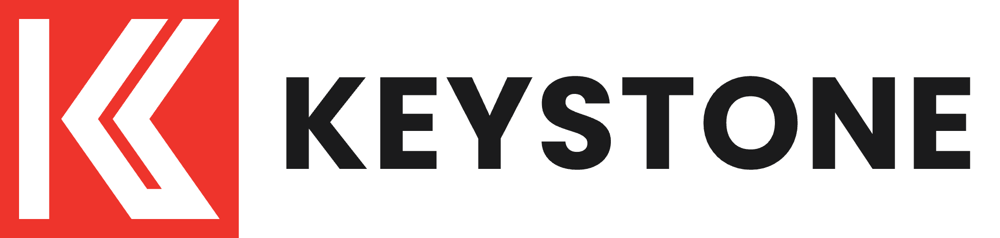
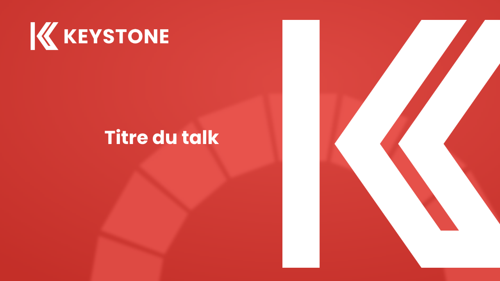
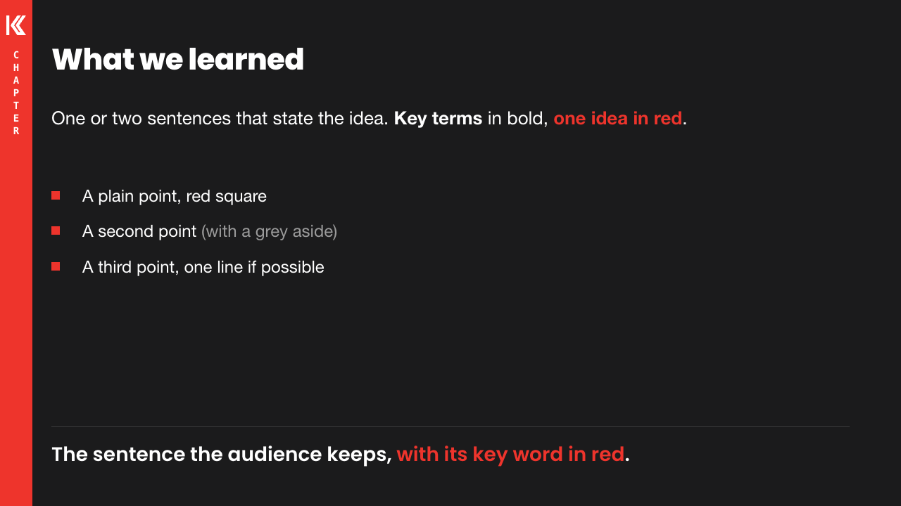
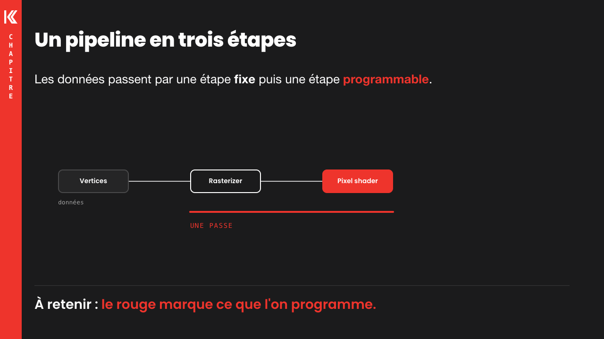
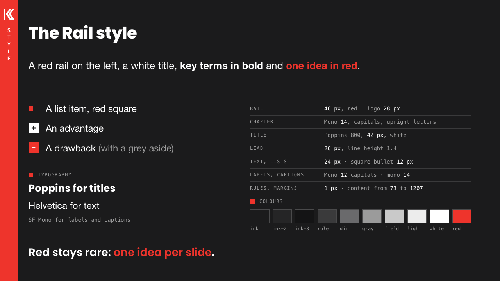
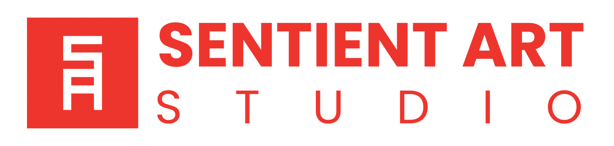

<p align="center"></p>

# Keystone

A local deck tool for technical talks. Each slide is an HTML fragment (1280×720) with its own CSS and JavaScript, so a
slide can hold a live three.js scene, a diagram that builds step by step, or a working demo. You write what a slide
must say in the browser; [Claude Code](https://claude.com/claude-code) styles it from a style library; you give
feedback by drawing and speaking over the slides.

<p align="center">



</p>

- **Presenter and editor** in the browser, with live reload.
- **Style library**: brand rules, style guides, layouts and components, each with an example slide, written for
  people and for LLMs.
- **Two languages per slide**: one `slide.html`, the translated text next to it.
- **Feedback sessions**: draw on the slides and talk; the voice is transcribed on your machine and Claude turns the
  session into tasks and slide changes.
- **Publishing**: a deck becomes a static, read-only talk for any website or static host.
- **No dependencies**: Node ≥ 22 and the files of this repository. Nothing to `npm install`.

## Contents

1. [Install](#install)
2. [Your decks](#your-decks)
3. [The presenter](#the-presenter)
4. [Decks and slides](#decks-and-slides)
5. [Working with Claude](#working-with-claude)
6. [The style system](#the-style-system)
7. [Languages](#languages)
8. [3D in slides](#3d-in-slides)
9. [Publishing a talk](#publishing-a-talk)
10. [Tools](#tools)
11. [Repository layout](#repository-layout)
12. [Licence](#licence)

## Install

Required: [Node.js](https://nodejs.org) 22 or later, and git.

```sh
git clone https://github.com/ancarmona/keystone.git
cd keystone
npm start
```

Open <http://localhost:4321> (the style library, one example slide per layout and component) and
<http://localhost:4322> (a small example deck, `examples/hello`).

Optional, for some features:

| Tool | For |
|---|---|
| [Claude Code](https://claude.com/claude-code) (`claude` on the `PATH`, signed in) | Styling slides, handling feedback, "Claude auto" |
| Google Chrome, Chromium or Microsoft Edge | Screenshots, WebP encoding, thumbnails of published talks (found by itself; `CHROME=<path>` to choose one) |
| [uv](https://docs.astral.sh/uv/) | Transcription of feedback recordings (Whisper `large-v3-turbo`, on your machine; the model downloads on first use) |
| `npx` (comes with Node) | `tools/meshopt.mjs` downloads gltfpack when it runs |

Keystone runs on macOS, Windows and Linux (`npm run check` tests it on yours). What differs:

| | macOS | Windows | Linux |
|---|---|---|---|
| Transcription | [mlx-whisper](https://github.com/ml-explore/mlx-examples/tree/main/whisper) on Apple silicon (faster-whisper on Intel) | [faster-whisper](https://github.com/SYSTRAN/faster-whisper): on an NVIDIA GPU (the CUDA libraries, about 1 GB, download with the first recording), else the CPU | faster-whisper, as on Windows |
| Claude's spoken answers | System voice (`say`) | A system voice of your language (Settings › Time & language › Speech); without one, the browser's voices | The browser's voices |
| Shortcuts | `⌘` | `Ctrl` | `Ctrl` |

Environment variables in the examples below are written for macOS and Linux (`DECK_LANG=fr npm run shots`); in
PowerShell: `$env:DECK_LANG="fr"; npm run shots`.

Server settings, as environment variables:

| Variable | Default | Use |
|---|---|---|
| `PORT` | `4321` | Port of a single deck (`node server.js <deck folder>`) |
| `HOST` | `127.0.0.1` | Listen on another address, e.g. a Tailscale address to open the presenter on a phone or a tablet |
| `DECK` | — | Deck folder to serve, same as the argument |

## Your decks

Keystone holds no talk of yours. Your decks go in `decks/`, a folder this repository ignores. Make it a git
repository of its own (a private one if you like), so the tool and your talks are versioned apart and you can pull
Keystone updates at any time.

```sh
mkdir decks && cd decks && git init
```

```
decks/
  keystone.json        the decks to serve, and their ports
  my-talk/             a deck
  public/              your files that replace Keystone's (your brand)
  CLAUDE.md            optional: instructions for Claude for all your decks (each deck can have its own too)
```

`decks/keystone.json` has the same format as `keystone.json`, with `dir` relative to `decks/`:

```json
{ "decks": [{ "dir": "my-talk", "port": 4330 }] }
```

`npm start` serves the decks of both files, each on its own port. To start a deck, open the overview (`O`) and click
**+ New deck**: give a title and choose a style guide. Keystone creates `decks/<id>/` with a cover slide, adds it to
`decks/keystone.json` and opens it on the next free port. To serve one deck alone: `node server.js decks/my-talk`
(or `node <keystone>/server.js` from inside the deck folder).

A deck folder can live anywhere on disk; `decks/` is only the place Keystone looks by default.

## The presenter

| Key | Action |
|---|---|
| `→` `↓` `Space` `PageDown` | Next build step or slide |
| `←` `↑` `PageUp` | Previous |
| `Home` / `End` | First / last slide |
| `O` | Overview: every slide, the other decks of the server, **+ New deck** |
| `E` | Editor: the brief of the slide, its speaker notes, a message to Claude |
| `F` | Full screen |
| `L` | The deck's next language (also `?lang=fr` in the address) |
| `R` | Record feedback (`R` again saves, `Escape` twice discards, `⌘Z` takes the last stroke back, `N` adds a slide) |
| `T` | Tasks: Claude's tasks from the feedback sessions, "Claude auto", the log of the last run |
| `D` | The feedback language as it is written |
| `⌘S` | Save the editor |

Pages reload by themselves when a file of the deck or of `public/` changes. The presenter keeps only the slides near
the current one loaded, so decks with many WebGL slides stay within the browser's limits.

## Decks and slides

```
my-talk/
  deck.json                  title, lang, style, order (the slide ids), publish settings
  slides/<id>/
    brief.json               what the slide must say: title, text, notes, status (todo | done)
    slide.html               the styled slide (missing: the brief is shown as a draft)
    slide.fr.json            the slide's text in another language (French here)
    checks.json              fact checks on the slide's text (optional)
  assets/                    the deck's media, at /deck/assets/…
  components/                the deck's own JS/CSS, at /deck/components/…
  server.mjs                 optional API routes of the deck
  feedback/                  feedback sessions (not in git)
```

You write the brief in the editor (`E`): a title, the text, the speaker notes. Saving a changed title or text sets
the slide to `todo`: it has to be styled again.

A `slide.html` is a fragment of a page, exactly 1280×720; the presenter scales it. It uses the theme's classes,
and can have its own `<style>` and `<script>`. A content slide in the default style starts with:

```html
<header class="sa-head"><h1 class="sa-band">CHAPTER</h1></header>
<h2 class="sa-title">The slide's title</h2>
<p class="sa-lead">One or two sentences that state the idea.</p>
<ul class="sa-list"><li>A point</li><li class="pro">An advantage</li><li class="con">A drawback</li></ul>
<p class="sa-takeaway">The sentence the audience keeps.</p>
```

- Addresses: `/public/…` for the tool's files (theme, components, three.js, logos), `/deck/…` for the deck's files;
  files in the slide's own folder can be referenced relatively.
- Entrance animations: `data-in="<ms>"` on an element, with `data-anim="rise|fade|pop|draw|wipe|drop"`.
- Events: the presenter fires `sa:enter` and `sa:leave` on the slide's `window` (start a video or an animation there).
- Links between decks: `<a href="deck:<id>#<n>">` opens slide `n` of another deck of the server.
- Images are WebP (`tools/webp.mjs` converts PNG and JPEG and rewrites the references).

[`CLAUDE.md`](CLAUDE.md) is the full reference: every convention, component and API route. Claude reads it; so can you.

## Working with Claude

Keystone is built to be used with Claude Code. `CLAUDE.md` and the style library tell Claude how a slide must look.

**In a terminal.** Run `claude` in the Keystone folder and ask, for example: *"Style the slides of decks/my-talk
that are to do."* Claude finds the briefs with `status: "todo"` or no `slide.html`, writes the slides from the style
library, checks them with screenshots (`npm run shots`) and sets them to `done`.

**With feedback sessions.** In the presenter, press `R`, then draw on the slides and talk, as you would to someone
next to you: *"move this image here"*, *"this is too long, cut it in two"*. Change slides as you go: one recording
can cover several slides. `R` saves. The session is written to `<deck>/feedback/<session>/feedback.ks` in a small
typed language: each stroke, the slide element under it, each word with its time, each slide change:

```
Enter e1(Time(0), "intro");
Stroke s1(Kind::Loop, Color::Red, Span(3634, 5059), Point(948, 559), Point(765, 275), Point(1009, 81));
Target t1(s1, "img.sa-intro-visual", "");
Say v1(Span(4150, 5050), Word(4150, "flip"), Word(4400, "this"), Word(4650, "image"));
Task k1(State::Todo, "intro", "Flip the photo horizontally", s1, v1);
```

Claude reads the session and the pictures of each slide with your strokes, writes one `Task` per request, then does
them. Each task shows as a pin on its slide (`T`): you can reply to it, record a follow-up, or close it. A question
from Claude is a `?` pin. You can also type a message to Claude in the editor instead of speaking.

**Claude auto.** In the tasks panel (`T`), the "Claude auto" switch makes the server start Claude Code by itself
(`claude -p`) each time a recording is saved or you reply to a task: no terminal needed. A fast pass (Sonnet) does
most tasks; a strong pass (Opus) follows for 3D work and for tasks that came back twice. The bottom-left corner shows
what Claude does, and a review dialog shows each changed slide before and after, with the changed lines. The models
are the `FAST` and `STRONG` constants of `server.js`.

The voice is transcribed on your machine by `tools/transcribe.py` (Whisper, through uv; see [Install](#install)).
It listens in your language (`userLang`, below).

## The style system

How a slide looks comes from three layers, from the most general to the most specific.

**1. The CSS: `public/tokens.css` and `public/theme.css`.** The tokens are the colours and the typefaces (`--ink`,
`--red`, `--display`…); the theme is every slide component (`.sa-title`, `.sa-list`, `.sa-card`, `.sa-takeaway`…).
They are the source of truth: slides use the tokens, never raw colours.

**2. The library: `library/`.** What a slide may look like, for people and for LLMs:

| Folder | Holds |
|---|---|
| `brand.md`, `brand.json` | Tone, words to avoid, colour rules, shapes, type sizes, logos |
| `styles/<id>/` | Style guides: the look of a whole deck |
| `layouts/<id>/` | Slide types: cover, chapter, list, canvas, pros and cons, agenda, closing, sources… |
| `components/<id>/` | Pieces: list, card, stat, label, caption, diagram, animation, three.js |

Each piece has a `.md` (judgement: when to use it, do and don't) and a `.json` (facts a script or an LLM can check:
classes, slots, limits), and an example slide. The library is itself a deck: `npm start` serves it on port 4321.
[`library/README.md`](library/README.md) is its index.

**3. Style guides: `library/styles/<id>/`.** A style guide is the look of a deck:

- `style.json`: `id`, `default` (the guide new decks get), `css` (`/public/theme.css`, or an extra stylesheet such as
  `/public/styles/<id>.css`, added to every slide after the theme), `media` (files of the library copied into each
  new deck, e.g. a cover photo).
- `style.md`: its rules. It starts with `# Style: Name`, then one paragraph that says what it looks like (the
  "New deck" dialog shows both).

A deck names its guide in `deck.json` (`"style": "<id>"`). Keystone has one guide today, **Rail**: a red rail down
the left edge with the logo and the chapter name, white sentence-case titles on a near-black ground. To add a guide,
copy `library/styles/rail/`, change its rules and give it a stylesheet.

<p align="center"></p>
<p align="center"><sub>The example slide of the Rail style (<code>library/slides/style-rail</code>): its rules and values on one slide.</sub></p>

**Your brand: `decks/public/`.** Keystone ships a neutral brand (the Keystone K). A file in `decks/public/` replaces
the file with the same path in `public/`, in the presenter and in published talks, so your decks carry your brand
while the repository stays untouched:

| Your file | Replaces |
|---|---|
| `decks/public/assets/brand/sa-monogram-white.svg` | The logo in the rail (white) |
| `decks/public/assets/brand/monogram.webp` | The large mark on covers and chapter slides |
| `decks/public/assets/brand/wordmark-white.webp`, `wordmark-color.webp`, `logo-icon.webp` | Logo and name, on red and on light grounds; the icon |
| `decks/public/tokens.css` | Colours and typefaces |
| `decks/public/reader/site.json` | Your site's name and links in published talks (see [Publishing](#publishing-a-talk)) |

Write your brand's tone and rules in `decks/CLAUDE.md`, so Claude follows them for your decks.

## Languages

Each deck is written in one language, set in `deck.json` (`"lang": "en"` by default), and can be translated into
others. A slide keeps one `slide.html` (markup, styles and code, in the deck's language); each translation is a
`slide.<lang>.json` next to it, so a layout change is made once. The example decks are written in English and
translated into French (`slide.fr.json`).

```json
{
  "blocks": { "What we learned": "Ce qu'on a appris", "A <b>key</b> point": "Un point <b>clé</b>" },
  "attrs":  { "Photo of the studio": "Photo du studio" }
}
```

- `blocks`: the whole content of an element (a title, a paragraph, a list item), so bold, links and line breaks can
  move in the translation. `attrs`: `alt`, `title` and `aria-label` values.
- Text written by code: `saT({ en: "Red", fr: "Rouge" })`; numbers: `n.toLocaleString(document.documentElement.lang)`.
- Text that needs more room in one language: an `html[lang="fr"] …` rule in the slide's `<style>`.
- The deck's title in other languages: `"titles": { "fr": "…" }` in `deck.json`.
- In the presenter: `L` (the deck's next language) or `?lang=fr`. The overview marks styled slides "Not translated",
  and "Translation outdated" when `slide.html` changed after the translation (those parts show in the deck's language).
- Screenshots of a translation: `DECK_LANG=fr npm run shots` → `<deck>/screenshots/fr/`.
- Published talks list their languages in `publish.languages` (the first is the default).

**Your language** is a separate setting: `"userLang": "fr"` in `decks/keystone.json` (English by default). Claude writes
its tasks and questions and speaks to you in it, your voice is transcribed in it, and new decks are written in it.

## 3D in slides

`public/components/stage.js` is a small three.js foundation for figures in slides:

```js
import { stage, loadModel } from "/public/components/stage.js";
const { render, scene, softShadow } = stage(canvas, 660, 410, { look: "pbr", env: "studio", draw });
```

Three looks: `unlit` (exact colours: checkers, UV views), `simple` (Blinn-Phong) and `pbr` (image-based lighting
from an Ultra HDR environment, ambient occlusion, soft contact shadows). The two environments, `studio` and
`exterior`, come from [Poly Haven](https://polyhaven.com) (CC0); `tools/env.py` converts any EXR, and
`public/assets/env/envs.json` sets each one's orientation, exposure and sun. It handles the pixel ratio when the
presenter scales the slide, and lowers its quality on phones. `loadModel()` loads glTF models compressed with meshopt
(`tools/meshopt.mjs`). See `library/components/three/` and the library's 3D example slides.

## Publishing a talk

```sh
node tools/deploy.mjs decks/my-talk --out <folder> [--url https://example.com]
```

It writes the deck as a static, read-only talk: `talks/<slug>/` (the reader page, the slides in each language,
thumbnails, a cover and a social image), `talks/_shared/` (theme, components, reader), `talks/index.json` (every
talk deployed to that folder). Any static server can host the folder, or point `--out` at your website's public
folder.

The settings are the `publish` block of `deck.json` (`examples/hello` has one):

```json
"publish": { "slug": "my-talk", "title": "My talk", "description": "…", "author": "…", "event": "", "date": "",
             "sourceLang": "fr", "languages": ["en", "fr"], "first": "", "skip": [], "cover": "cover",
             "requires": "webgl" }
```

Only published files leave the deck: never briefs, notes, fact checks or feedback; deck files only when a slide uses
them; slides not styled yet are skipped. Links to other decks become links to their published talks.

The reader's host settings are in `public/reader/site.json` (yours: `decks/public/reader/site.json`):

| Field | Use |
|---|---|
| `name` | Site name, in the page title |
| `url` | Site address, for social previews (`--url` wins) |
| `home`, `index` | Links of the logo and of the close button |
| `railPrefix` | Words before the chapter in the reader's rail (e.g. `Built to`) |
| `follow` | `[["Name", "https://…"], …]`: links on the last card |
| `contact`, `work` | Contact link, and the text above it (`{ "en": "…", "fr": "…" }`) |

## Tools

| Command | Does |
|---|---|
| `npm run check` | Tests Keystone on this machine: scripts, the example decks in both languages, screenshots, publishing (also run on GitHub, on macOS, Windows and Linux) |
| `npm run shots [-- <ids>]` | Screenshots of the served deck's slides at rest, in `<deck>/screenshots/` (`PORT=<port>` for another deck) |
| `node tools/cdp-check.mjs <n> "wait:1000,shot:a,key:ArrowRight,shot:b" <out>` | Plays slide `n` in the real presenter, with keys, and takes screenshots: for builds and animations |
| `node tools/webp.mjs <folder> … [--dry]` | PNG and JPEG to WebP, references rewritten |
| `node tools/meshopt.mjs <folder or .glb>` | Compresses glTF geometry (run after every GLB export) |
| `node tools/asset.mjs <file> … <deck folder>` | Copies media into a deck's `assets/` |
| `uv run tools/env.py <in.exr> <out.uhdr.jpg>` | An HDR environment for the `pbr` look |
| `node tools/ks.mjs <feedback.ks>` | Checks a feedback session file |
| `node tools/deploy.mjs …` | Publishes a deck (above) |

## Repository layout

```
server.js            static server, JSON API, live reload, Claude runs
keystone.json        the decks of this repository (library, example)
public/              the tool, served at /public/: presenter (index.html), tokens, theme, components, fonts, three.js, reader
library/             the style library (also a deck)
examples/hello/      a small example deck
tools/               screenshots, publishing, images, models, transcription, feedback language
docs/logo/           the Keystone logo (SVG)
CLAUDE.md            the full reference, for Claude and for you
decks/               your decks and your brand (not in this repository)
```

## Licence

[Apache License 2.0](LICENSE). You can use, copy, change and sell Keystone and works based on it, for personal or
commercial use. If you distribute it or a work based on it, keep the [`NOTICE`](NOTICE) file with it: it credits
Sentient Art. Third-party files keep their own licences: [`THIRD_PARTY.md`](THIRD_PARTY.md).

The Clawd animations that the presenter can show are not part of Keystone; without them it shows a plain pixel
mascot.

---

<p align="center">Made by <a href="https://sentient-art.xyz">Sentient Art</a><br><br>
<a href="https://sentient-art.xyz"></a></p>
